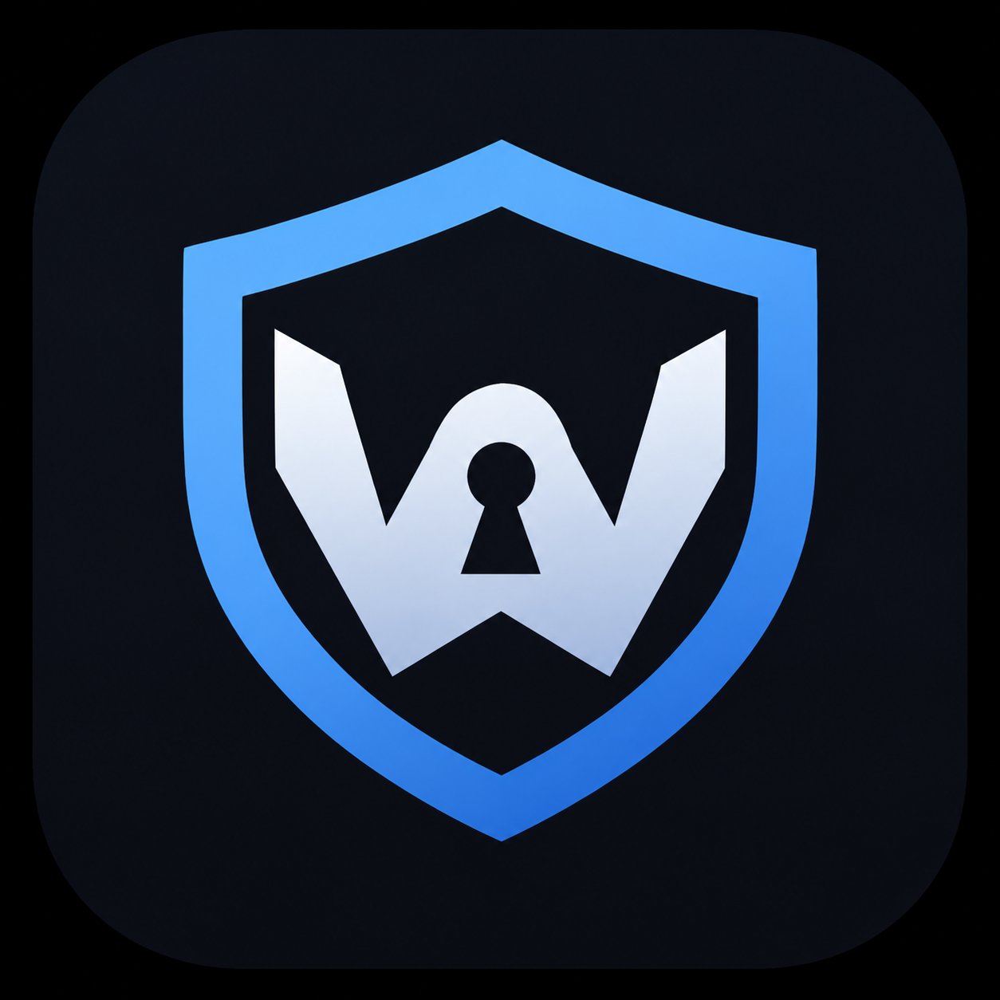

# warden-browser
Privacy-first C++ desktop browser with zero-knowledge encrypted accounts, tracker &amp; ad interception, live wallpapers, and auto-switching AI assistant.

<div align="center">
  
  <h1>Warden Browser</h1>
  <p><strong>A fast, privacy-hardened, cross-platform desktop web browser built with modern C++20 and Qt6 WebEngine.</strong></p>
</div>

### ✨ Key Features

* **🔒 Core-Level Privacy (C++ Interceptor):** A native network request interceptor blocks trackers and ads before they load, enforces HTTPS-Only mode (`http://` to `https://`), strips cross-origin `Referer` headers, and prevents WebRTC IP leaks.
* **🌐 Tor / SOCKS5 Support & "Burn Session":** One-click routing through a local Tor proxy (`127.0.0.1:9050`) and instant destruction of cookies, cache, and active tabs via a single hotkey.
* **☁️ End-to-End Encrypted (E2EE) Accounts:** Isolated local SQLite profiles with optional cross-device cloud sync powered by client-side **AES-256-GCM** encryption.
* **🤖 Auto-Switching AI Sidebar:** Built-in side panel with free AI assistants (ChatGPT, DuckDuckGo AI Chat, HuggingChat) that automatically switches to the next available model when message limits are reached.
* **🎨 Customizable New Tab Page:** Minimalist start page with search engine selection (DuckDuckGo, Google, Yandex) and custom backgrounds (live wallpapers, custom local images, or solid colors).
* **📦 Cross-Platform Packaging:** Native installers for **Windows** (`.exe`), **Linux** (`.deb`, `.pkg.tar.zst`, `.rpm`), and **macOS** (`.dmg`).

---

### 🚀 Installation & Building

Pre-built installers for Windows and Linux are available on the **[Releases](../../releases)** page.

#### Build from Source (CMake + Qt6)
```bash
git clone https://github.com
cd warden-browser
cmake -B build -DCMAKE_BUILD_TYPE=Release
cmake --build build --parallel
```

---

### 🔐 Cloud Sync Configuration
By default, all user accounts operate completely offline in local mode. To enable cross-device cloud synchronization, add your `supabase_url` and `supabase_anon_key` to `cloud_config.json` (the database schema is provided in `supabase_setup.sql`).
